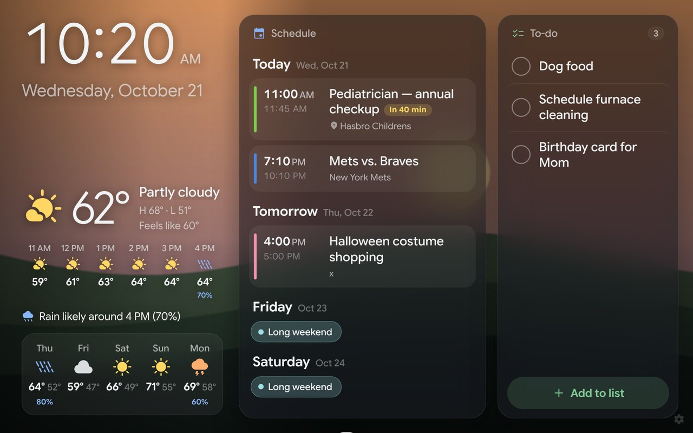

# Kitchen Dashboard

A full-screen wall display for an always-on Android tablet. It shows your **Google Calendar**, a **household to-do list**, **weather** (current, next 6 hours and 5-day), a big **clock**, and optional **background photos**. The design follows the dark, ambient Nest Hub style, with type large enough to read from across the kitchen.


| With a background photo | Night mode |
|---|---|
|  |  |

## What it does

- **Schedule.** Shows today's remaining events, then tomorrow and the next few days. The event in progress gets a **Now** badge and a progress bar. An event starting within the hour shows a countdown (**In 25 min**). All-day events appear as pills, events you declined are hidden, and each calendar keeps its own color.
- **To-do list.** Tap an item to check it off; you get an Undo toast. **Add to list** opens a big text box with a microphone button for voice entry. Commas add several items at once: "eggs, milk, bread".
- **Weather.** Current conditions, a one-line rain outlook ("Rain likely around 4 PM"), the next 6 hours and the next 5 days. It comes from [Open-Meteo](https://open-meteo.com), which is free and needs no API key.
- **Photos.** Optional. A slow-zooming, cross-fading background picture taken from a Google Drive folder.
- **Night mode.** From 10:30 PM to 6 AM by default, the screen turns black with a dim clock and your next event. Tap it to bring the full dashboard back for 2 minutes.
- **Hands-off.** It refreshes every 2 minutes, reloads itself nightly at 3:30 AM, keeps the screen awake, and shows a small notice if it loses its connection.

### About Google Keep and Google Photos

- **Keep has no API for personal Google accounts**, so no app can read or write Keep lists. The dashboard uses **Google Tasks** instead, with a list named "Household". You can add to that list from the tablet, from the Google Tasks app on your phone, from Gmail or Calendar's Tasks side panel, or by asking Gemini. Anything added there appears on the wall within 2 minutes.
- **Google Photos stopped letting apps browse your library in 2025.** Put the pictures you want in a **Google Drive folder** instead. You can drag a downloaded album into it.

## How it fits together

```
 Tablet (Chrome / Fully Kiosk)                 Your Google account
┌──────────────────────────────┐   JSON    ┌───────────────────────────────┐
│ dashboard/  (static web app) │ ◄──────── │ apps-script/Code.gs           │
│  index.html · styles.css ·   │ ────────► │ Calendar · Tasks · Drive      │
│  app.js                      │  add/done │ (runs as you, no tokens to    │
└──────────────┬───────────────┘           │  expire on the tablet)        │
               │ weather                   └───────────────────────────────┘
               ▼
          Open-Meteo
```

A small **Google Apps Script** runs inside your Google account and serves your calendar, tasks and photos. The tablet never stores Google login tokens, so nothing expires at 3 AM and leaves a blank screen. It only holds a secret phrase that the script checks on every request.

---

## Setup (about 15 minutes)

### Step 1: The Google backend

1. Go to **[script.google.com](https://script.google.com)** and click **New project**. Name it "Kitchen Dashboard".
2. Delete the sample code and paste in the contents of [`apps-script/Code.gs`](apps-script/Code.gs).
3. At the top, under `CONFIG`:
   - Change `SECRET` to a long random phrase, such as `purple-toaster-lighthouse-9271`.
   - Optionally list calendars to hide in `EXCLUDE_CALENDAR_NAMES`, for example `['New York Mets', 'Holidays in United States']`. By default the dashboard shows every calendar that's checked in your Google Calendar sidebar.
   - Optionally set `PHOTOS_FOLDER_ID` (see "Photos" below).
4. Turn on Google Tasks: in the left sidebar, click **Services (+)**, choose **Google Tasks API**, then **Add**.
5. Choose **testSetup** in the function dropdown on the toolbar and click **Run**. Google will ask for permission.
   - You'll see "Google hasn't verified this app". That's expected, because this is your own script. Click **Advanced → Go to Kitchen Dashboard (unsafe) → Allow**.
   - The log should list a few of your events and tasks.
6. Click **Deploy → New deployment**, then the gear icon → **Web app**:
   - **Execute as:** Me
   - **Who has access:** Anyone. This is required so the tablet can connect without signing in. The secret phrase keeps strangers out.
   - Click **Deploy** and copy the **Web app URL** (it ends in `/exec`).

> When you change `Code.gs` later, use **Deploy → Manage deployments → Edit (pencil) → Version: New version** so the URL stays the same.

### Step 2: Host the dashboard

The dashboard is static files, so any web host works. The simplest option is **GitHub Pages** from this repo:

1. Push this repo to GitHub (the workflow publishes from `main`).
2. In the repo, go to **Settings → Pages → Build and deployment → Source** and choose **GitHub Actions**.
3. The included workflow (`.github/workflows/pages.yml`) publishes the `dashboard/` folder. Your URL will be `https://<your-username>.github.io/<repo-name>/`.

GitHub Pages on a private repo needs a paid GitHub plan. Otherwise make the repo public; the dashboard code has no secrets in it, because your secret lives only on the tablet. Any other static host works too, such as Netlify or Cloudflare Pages: drag in the `dashboard/` folder.

### Step 3: Set up the tablet

1. Open the dashboard URL in Chrome. You'll see sample data first.
2. Tap the faint **⚙ gear** in the bottom-right corner:
   - Paste the **Backend URL** and **Secret key** and tap **Test connection**. You should see ✓ Connected.
   - Search for your city or ZIP code for weather.
   - Choose °F/°C, 12- or 24-hour time, night-mode hours and photo timing.
   - Tap **Save**.
3. Make it full-screen and permanent. Pick one:
   - **Fully Kiosk Browser** (recommended, from the Play Store): set the Start URL to your dashboard. It keeps the screen on, relaunches after a reboot or crash, and can lock the tablet to this one page. The free version is enough.
   - **Chrome only:** tap ⋮ → **Add to Home screen**. Launching from that icon opens it full-screen. Also set the tablet's screen timeout to "never", or stay awake while charging under Developer options.

Settings are stored on the tablet. To show the dashboard on another device, such as a phone so others can add to the list, open the same URL there and enter the same backend URL and secret.

### Photos (optional)

1. Create a folder in Google Drive and put photos in it.
2. Open the folder. The ID is the last part of the URL: `drive.google.com/drive/folders/`**`1AbC…xyz`**.
3. Paste it into `PHOTOS_FOLDER_ID` in `Code.gs`, click **Run → testSetup** again (it will ask for Drive permission), then deploy a **new version** as described above.

New photos added to the folder appear within about an hour.

## Files

| Path | What it is |
|---|---|
| `dashboard/index.html`, `styles.css`, `app.js` | The wall display (no build step) |
| `dashboard/manifest.webmanifest`, `icon.svg` | Lets it install full-screen from Chrome |
| `apps-script/Code.gs` | The Google backend: calendar, tasks, photos |
| `apps-script/appsscript.json` | Optional manifest (enables Google Tasks for you, if you show it in the editor's Project Settings) |
| `.github/workflows/pages.yml` | Publishes `dashboard/` to GitHub Pages |

## Troubleshooting

- **"Can't reach Google right now" at the bottom.** The tablet is offline or the script errored. Open the backend URL with `?action=dashboard&key=YOUR_SECRET` in a browser to see the error.
- **"Secret key doesn't match".** The secret in Settings must match `SECRET` in `Code.gs` exactly. If you changed it, remember to deploy a new version.
- **Edits to `Code.gs` don't take effect.** You need to deploy a **new version** (Step 1 note).
- **A calendar is missing.** Make sure it's checked in Google Calendar's sidebar on the web, or list its ID in `CALENDAR_IDS`.
- **Apps Script daily limits.** A personal account allows 90 minutes of script runtime per day. The dashboard uses roughly 15 to 25 minutes with photos on.
