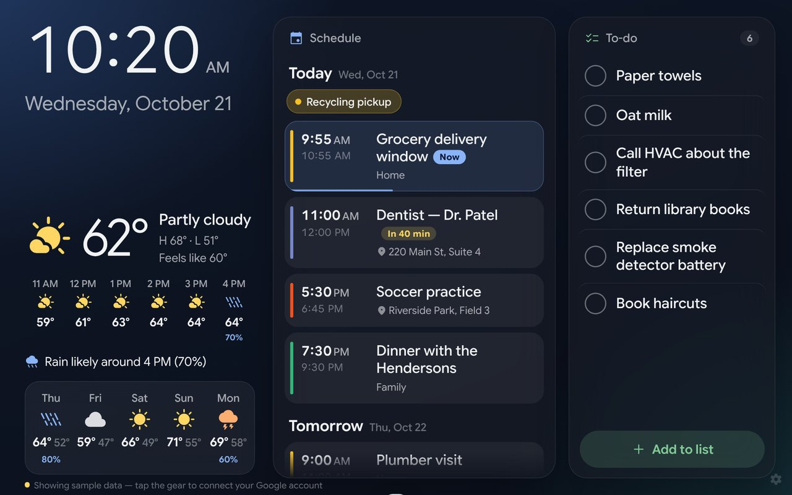
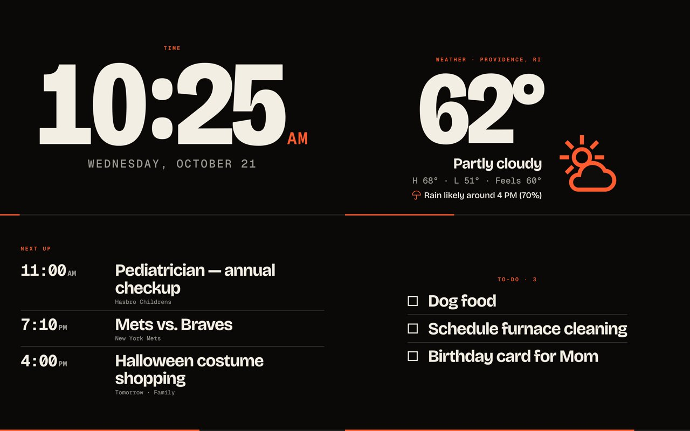
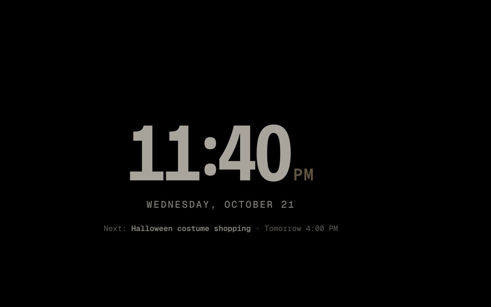
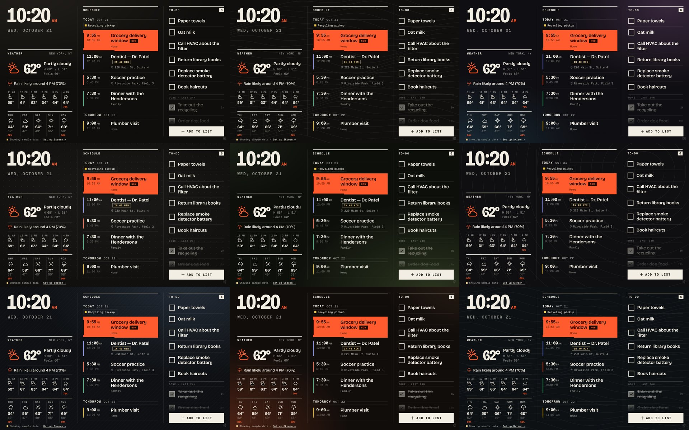

# Skreen

A wall display for an always-on Android tablet: **Google Calendar**, a **household to-do list**, **weather**, a very large **clock**, and soft rotating **backgrounds**. Sign in with Google and you're done. It has its own look: ink-black, bone-white type, one signal-orange accent, square corners and big, confident numerals. Self-hosted fonts, no Google fonts.



| Big-screen tour (anti burn-in) | Night mode |
|---|---|
|  |  |

## What it does

- **Schedule.** What's left today, then the next few days. The event in progress is a solid orange block with a progress bar; one starting within the hour gets a countdown. All-day events become tags, declined events are hidden.
- **To-do list.** Tap to check off. **Checked items stay on screen, struck through, for 24 hours**, then vanish; tap one to bring it back. Add items with the big button, by voice, or from your phone via Google Tasks.
- **Weather.** Now, the next 6 hours, 5 days, and a plain-English rain outlook. Open-Meteo, no key.
- **Typefaces.** Five to choose from in Settings (Bricolage, Fraunces, Archivo, Space Grotesk, Big Shoulders), self-hosted and previewed live.
- **Backgrounds.** Nine soft, dark colour-gradient backgrounds with gentle contrast, one per day, or pin your favourite. No lines or patterns, so text always reads cleanly.
- **Big-screen tour.** Every 5 minutes (adjustable) it spends ~30 seconds on **BIG time → BIG weather → BIG calendar → BIG to-do**, alternating left/centre/right. Tap to end it early.
- **Burn-in care.** The tour, a slow few-pixel layout drift, a night mode (black screen, dim wandering clock, next event) and moving backgrounds keep any pixel from staying lit.
- **Google sign-in.** In the Android app: tap *Sign in with Google*, pick your calendars and to-do list. Skreen talks to Google directly from the tablet; there is no server of ours and nothing is stored elsewhere.
- **Setup guide built in.** Tap the gear → **Setup guide**. It covers sign-in, installing on the tablet, burn-in and troubleshooting, with no GitHub required.



### About Google Keep

Keep has no API for personal accounts, so the list lives in **Google Tasks**, which you can edit from your phone, Gmail, Calendar or Docs.

## How it fits together

```
 Skreen Android app  ──── Google sign-in ────►  Google Calendar + Tasks APIs
 (WebView shell +         short-lived token       (read calendars, manage one
  native sign-in)         from Play Services       task list)
        │ loads
        ▼
 dashboard/  (this static site, on GitHub Pages)  ──►  Open-Meteo (weather)
```

Everything is read straight from Google by the tablet. In a plain browser, where Google sign-in isn't available, Skreen can instead use a small Apps Script in your own Google account (see the in-app guide, *Browser version*).

## Setup

Everything is explained **inside the app** (⚙ → Setup guide).

1. **Host the page.** This repo publishes `dashboard/` with GitHub Pages: **Settings → Pages → Source: GitHub Actions** (the repo must be public on the free plan).
2. **Google Cloud project** (once, about 10 minutes): see [`docs/launch.md`](docs/launch.md) for the exact steps and the signing fingerprint to register.
3. **Install the Android app** (below), open it, tap **Sign in with Google**, pick your calendars and list, and choose your city.

## The Android app

`android/` is a small native shell around the dashboard: full-screen, screen always on, and it can **dim the screen itself** (day and night levels in Settings), which is the best burn-in protection there is. It also uses the system speech recognizer for the microphone button, and can optionally be set as the tablet's Home app so it starts at boot.

**It loads your live GitHub Pages site**, so edits to `dashboard/` reach the tablet as soon as Pages deploys, with no reinstall (the site's service worker keeps it running through Wi-Fi drops, and a copy bundled in the APK is a last-resort fallback). You only reinstall when `android/` changes. GitHub builds the APK automatically (`.github/workflows/android.yml`) and keeps the newest build at:

**`https://github.com/<you>/<repo>/releases/latest/download/Skreen.apk`**

Open that on the tablet in Chrome, allow *install unknown apps* when asked, and install. Updates install over the old version and keep your settings (every build is signed with the same key in `android/skreen-sideload.jks`, which is deliberately public: it's for personal sideloading, not the Play Store). Fully Kiosk Browser or Chrome's *Add to Home screen* still work if you'd rather not sideload.

## Files

| Path | |
|---|---|
| `dashboard/index.html`, `styles.css`, `app.js` | The display |
| `dashboard/icons.js`, `backgrounds.js`, `guide.js`, `google.js` | Icons, built-in backgrounds, in-app guide, Google Calendar/Tasks client |
| `dashboard/setup/Code.gs`, `appsscript.json` | Optional Apps Script backend for plain browsers |
| `dashboard/privacy.html` | Privacy policy (needed for Google verification) |
| `docs/launch.md` | Google Cloud setup, verification and store checklist |
| `dashboard/fonts/` | Bricolage Grotesque, Fraunces, Archivo, Space Grotesk, Big Shoulders and Geist Mono (all SIL OFL) |
| `dashboard/sw.js`, `manifest.webmanifest`, `icon.svg` | Offline fallback and installability |
| `android/` | The Android app (bundles `dashboard/`) |
| `.github/workflows/pages.yml` | Publishes `dashboard/` to GitHub Pages |
| `.github/workflows/android.yml` | Builds `Skreen.apk` and publishes it to the latest release |
